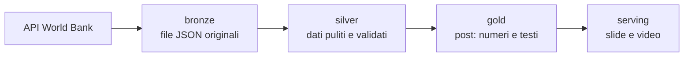
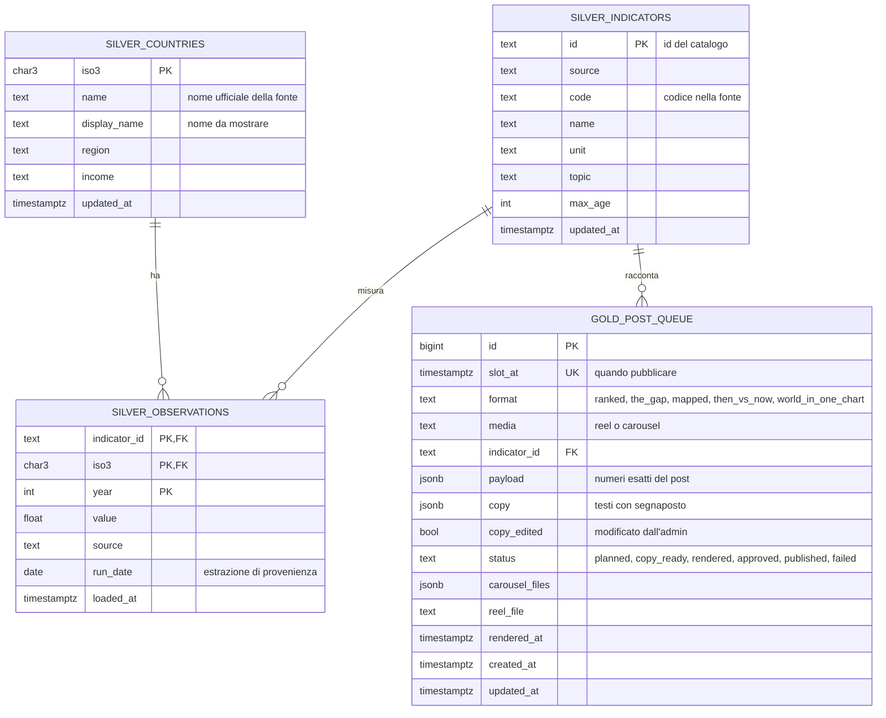

# Planet Plotted

Pipeline dati che ogni giorno scarica indicatori mondiali dalla World Bank,
li pulisce, decide cosa pubblicare, scrive i testi e crea i post per Instagram
(carosello, e presto reel). In futuro alimenterà anche un sito con API e area admin.

**Regola del progetto: mai inventare nulla.** I dati scaricati non si modificano,
nel database non si stimano né si arrotondano valori, e nei testi i numeri
entrano solo tramite segnaposto calcolati dai dati.

## Architettura a strati

Il progetto segue l'architettura *medallion*: ogni strato legge il precedente
e scrive il suo. Ogni tappa è uno script indipendente, lanciabile a mano,
da Airflow o da un altro orchestratore senza cambiare il codice.



| Strato | Codice | Legge | Scrive |
|---|---|---|---|
| **bronze** | `bronze/worldbank.py` | API World Bank | `data/bronze/` (o S3) |
| **silver** | `silver/clean.py` | bronze | schema `silver` |
| **gold** · plan | `gold/plan/schedule.py` | `silver` | `gold.post_queue` (payload) |
| **gold** · copy | `gold/copywriting/generate.py` | `gold.post_queue` | `gold.post_queue` (copy) |
| **serving** · render | `serving/render/post.py` | `gold.post_queue` | `data/renders/` |

## Struttura

```
bronze/            extract: uno script per fonte, salva i dati così come arrivano
  worldbank.py       scarica indicatori e anagrafica paesi
  check_catalog.py   controlla codici e copertura del catalogo contro l'API
silver/            pulizia e qualità
  clean.py           toglie aggregati e valori mancanti, carica lo schema silver
  checks.py          controlli di qualità (la pipeline si ferma se falliscono)
  export_names.py    genera catalog/country_names.yml con tutti i paesi
gold/              dati pronti all'uso
  plan/              sceglie formato e indicatore per ogni slot e calcola i numeri
  copywriting/       testi con segnaposto, formattazione dei numeri, modelli
serving/           output pubblicabili
  render/            slide del carosello (e reel), mappa Equal Earth, font e confini
catalog/           configurazione: indicatori, programmazione, nomi dei paesi
common/            config, connessione al database, storage bronze
brand/             colori, loghi, font Manrope, confini dei paesi
dags/              DAG di Airflow
sql/               schema del database (silver e gold)
tests/             test
data/              file generati (non versionati): bronze/ e renders/
```

## Modello dei dati



`silver.observations` è in formato "lungo" (una riga per indicatore, paese e anno):
è la forma più semplice da interrogare sia per i post sia per il sito.

## Primo avvio

Serve Docker Desktop.

```bash
cp .env.example .env
docker compose up -d --build
```

Font e confini dei paesi sono già nel repository. Per rigenerarli:
`python -m serving.render.setup_fonts` e `python -m serving.render.setup_map`.

- **Airflow:** http://localhost:8080, utente `admin`. Password:
  `docker compose exec airflow cat /opt/airflow/standalone_admin_password.txt`.
  Se il login non funziona, crea l'utente:
  `docker compose exec airflow airflow users create --username admin --password admin --firstname Admin --lastname User --role Admin --email admin@example.com`
- **Postgres:** `localhost:5432`, database, utente e password `planetplotted`
  (estensione PostgreSQL di VS Code o DBeaver). Tabelle negli schemi `silver` e `gold`.

In Airflow attiva il DAG `planetplotted_daily`: gira ogni giorno alle 4:00 UTC.

## Lanciare le tappe a mano

```bash
docker compose exec airflow bash
cd /opt/planetplotted
python -m bronze.worldbank --countries --run-date 2026-11-08
python -m bronze.worldbank --run-date 2026-11-08
python -m silver.clean --run-date 2026-11-08
python -m gold.plan.schedule --date 2026-11-09
python -m gold.copywriting.generate --date 2026-11-09
python -m serving.render.post --date 2026-11-09
```

- `gold.plan.schedule --replace` rifà i post del giorno non ancora renderizzati e mai modificati a mano.
- `serving.render.post --post-id 7` renderizza un solo post.
- `bronze.check_catalog` controlla il catalogo prima di aggiungere indicatori.

## Configurazione senza toccare il codice

- **`catalog/indicators.yml`:** gli indicatori. `additive: true` solo per valori
  sommabili; `below_half_phrase` per la frase "In X of N countries…".
- **`catalog/schedule.yml`:** slot giornalieri (orari UTC, reel o carosello), formato e tema
  per ogni giorno, soglia di popolazione per The Gap e per le liste delle mappe.
- **`catalog/country_names.yml`:** il nome da mostrare per ogni paese
  (`python -m silver.clean` per caricarli).
- **`gold/copywriting/templates.yml`:** i modelli dei testi, con soli `{segnaposto}`
  e parole neutre ("highest", "lowest").

## Regole sui dati

- **Aggregati esclusi** (World, Euro area…): non sono paesi.
- **Pari merito calcolati sui valori come appaiono** nel post.
- **The Gap:** differenza in punti per le percentuali, rapporto "N×" solo tra valori positivi,
  zeri esclusi, solo paesi con almeno 1 milione di abitanti.
- **Mapped:** ultimo dato disponibile per ogni paese entro `max_age` anni, dichiarato nella slide;
  almeno 120 paesi; liste senza microstati.
- **Barre sempre da zero:** sul 100% per le quote "% of", sul valore più alto per tassi e totali.

## Quando ricostruire Docker

- Codice Python, YAML o DAG: **niente**, la cartella è montata nel container.
- `requirements.txt` o `Dockerfile`: `docker compose up -d --build`.
- `docker-compose.yml`: `docker compose up -d`.
- File in `sql/`: girano solo con il database vuoto. Per ripartire da zero:
  `docker compose down -v`, poi `docker compose up -d` e rilancia la pipeline
  (i dati si riscaricano dalla World Bank).

## Test

```bash
pip install -r requirements-dev.txt
pytest
```

## Prossimi passi

1. Caroselli Then vs Now e The World in One Chart, poi il reel (MP4).
2. Indicatori pro capite affiancati ai totali (es. CO2 per persona e totale nazionale).
3. API (FastAPI) e sito (Next.js) con grafici e area admin.
4. Produzione: Postgres serverless, object storage, Airflow su macchina virtuale, Terraform.
